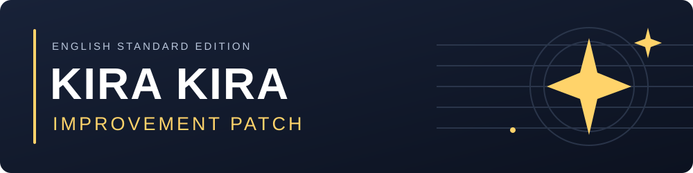
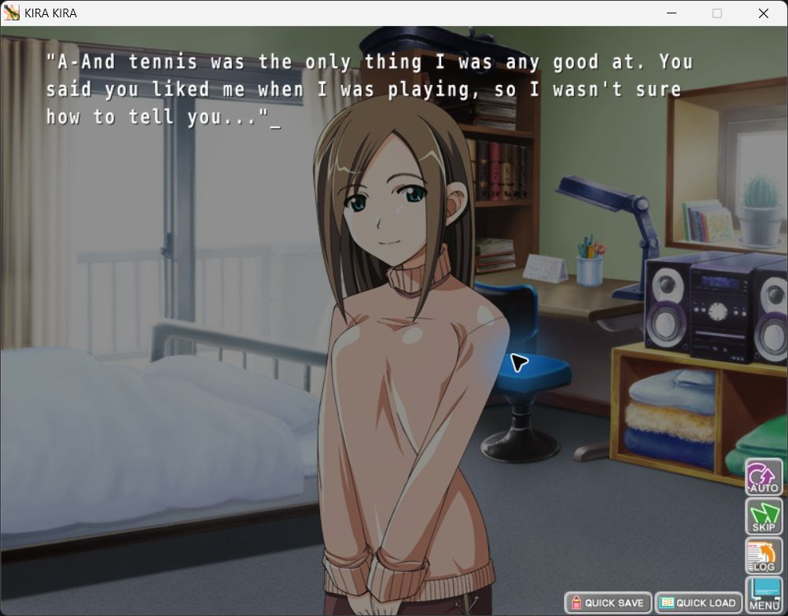

  

  <strong>A clearer, more accurate English script. A more readable game.</strong>

  

  <a href="#installation">Installation</a> · <a href="#before-and-after">Before and after</a> · <a href="#existing-saves">Existing saves</a> · <a href="https://github.com/Dern00/Kira-Kira-Improvement-Patch/issues">Report an issue</a>

**Requires the English Standard Edition of Kira Kira.** This patch is not for Curtain Call or the Japanese edition. The game is not included.

## What this project sets out to do

The goal is a clearer, more accurate English script that preserves Kira Kira's story, character voices, humor, and personality. The existing translation was checked against the original Japanese to correct mistaken or missing meaning, broken grammar, and awkward phrasing, while keeping good localization and natural English.

The patch also replaces the original game font with a clearer bold font for more comfortable reading.

- **Translation corrections:** fix misread meanings, confused subjects, and lost details.
- **Clearer English:** repair broken sentences while keeping dialogue lively and characterful.
- **Better readability:** a clearer font, with wrapping and long passages checked in-game.

## Before and after

These examples compare the original English release with the text in the patch.

### A character description with the wrong meaning

| Original | Patched |
| --- | --- |
| Kirari is sensual. | Kirari is the intuitive type. |

The scene is about writing lyrics. The Japanese describes Kirari's intuitive creative approach, not sensuality.

### Broken narration

| Original | Patched |
| --- | --- |
| The silence is making the air in the feel heavy. I have to say something. | The silence hangs heavy. I need to say something, anything. |

### A garbled description

| Original | Patched |
| --- | --- |
| So what this situation makes is a man in girls in the dressing room. | The result is that I am the one man in a dressing room full of women. |

### Dialogue that needs more than a typo fix

| Original | Patched |
| --- | --- |
| "Sure. I want to wipe off the image of our club. I want to appeal our existence before we're gone. Actually that's Kirari, our leader, thinks." | "Sure. We can finally erase the Second Literature Club's image as plain and practically invisible, and make sure people remember we existed. Besides, it is what Kirari, our leader, wants." |

## A clearer font

The patch uses KiraMono Bold and loads it automatically when you launch **BGI.exe**.

  

## Installation

1. [Download v1.4](https://github.com/Dern00/Kira-Kira-Improvement-Patch/releases/download/v1.4/Kira.Kira.Improvement.Patch.v1.4.zip) and extract the whole ZIP outside your game folder.
2. Close the game, then double-click **Install.cmd**.
3. Select the game folder containing **BGI.exe**.
4. Launch **BGI.exe** normally.

You can install the patch before the game's first launch. To update an earlier patch installation, run the new **Install.cmd** on the same folder. Saves and original uninstall backups are preserved.

## Existing saves

Existing saves are left untouched. However, the first page shown after loading an older save may retain old wording or display incorrectly, and older backlog entries may retain the original text. In testing, advancing to the next page restored normal patched text. Full compatibility with every old save is not guaranteed.

For the cleanest experience, start a new game. If continuing an old save, keep a backup, advance past the loaded page, then save in a new slot. Keep your original save.

## Removing the patch

Run **Uninstall.cmd** and select the same game folder. It restores the files from before installation and leaves saves alone. Keep the **KiraKira_Improvement_Backup** folder until you no longer need to uninstall.

---

Found an issue? [Report it here](https://github.com/Dern00/Kira-Kira-Improvement-Patch/issues). A screenshot and the surrounding dialogue help identify the passage.

[Plain-text instructions](README.txt) · [Release notes](https://github.com/Dern00/Kira-Kira-Improvement-Patch/releases/tag/v1.4) · [Font license](FONT_LICENSE.txt)

All original game rights remain with their owners.
